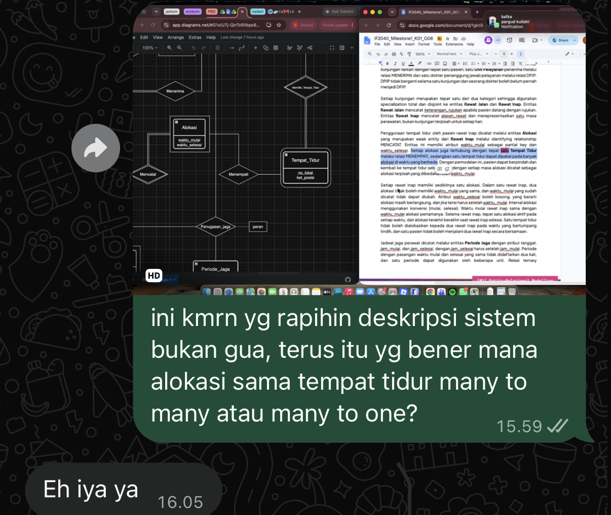

## Kompetensi target

Memilih target person yang tepat dan membuat issue diakui relevan melalui evidence.

## Evidence wajib

- Target map dan alasan memilih satu target.
- Problem/opportunity pitch serta evidence.
- Response, state sesudah pitch, dan adaptation.

::: {.callout-tip title="Lihat contoh pengisian"}
[Buka contoh fiktif Minggu 6](../examples/week-06.qmd) untuk melihat tingkat kekonkretan evidence dan analisis. Jangan menyalin contoh sebagai evidence pribadi.
:::

## Konteks performance

**Tanggal dan setting:** Interaksi ini terjadi ketika saya mengerjakan tugas besar mata kuliah Pemodelan Basis Data bersama empat anggota kelompok lainnya. Setelah seorang anggota menyelesaikan bagiannya, saya melanjutkan pengerjaan pada bagian saya yang menggunakan jawabannya sebagai referensi.

**Persons dan relationship:** Orang-orang yang terlibat adalah saya, ketua kelompok, dan seorang anggota yang mengerjakan bagian sebelum saya. Identitas mereka dianonimkan untuk menjaga privasi. Saya tidak terlalu dekat dengan anggota tersebut, sedangkan ketua kelompok memiliki peran untuk mengoordinasikan pekerjaan dan komunikasi antaranggota.

**Objective dan initial state:** Tujuan awal saya adalah memastikan apakah kesalahan terdapat pada jawaban anggota tersebut atau pada jawaban saya sendiri. Jika hasil pemeriksaan menunjukkan bahwa jawaban sebelumnya memang salah, saya ingin kesalahan itu diperbaiki agar bagian saya dan hasil akhir tugas tidak ikut menjadi keliru. Pada awal interaksi, ketua kelompok belum mengetahui adanya kesalahan tersebut.

## Target map

| Person | Relevance | Authority | Current state |
|---|---|---|---|
| Ketua kelompok | Bertanggung jawab mengoordinasikan jawaban dan memastikan tugas kelompok konsisten | Dapat memeriksa masalah serta meminta anggota terkait melakukan perbaikan | Belum mengetahui masalah |
| Anggota yang mengerjakan bagian sebelumnya | Jawabannya menjadi referensi bagi bagian saya dan memengaruhi hasil tugas | Dapat memperbaiki jawabannya sendiri | Belum menyadari kesalahan |
| Anggota kelompok lainnya | Ikut berkepentingan terhadap kualitas hasil akhir tugas | Dapat memberikan pendapat atau membantu pemeriksaan | Belum dilibatkan |

Saya memilih **ketua kelompok** sebagai target awal. Saya tidak terlalu dekat dengan anggota yang mengerjakan bagian sebelumnya sehingga merasa kurang nyaman jika langsung menghubunginya secara pribadi. Selain itu, ketua kelompok dapat membantu memeriksa terlebih dahulu siapa yang melakukan kesalahan dan kemudian menyampaikan hasilnya kepada anggota terkait. Pilihan ini juga mengurangi risiko saya langsung menuduh teman sebelum kebenarannya dipastikan.

## Attention pitch

Saya menghubungi ketua kelompok dan menjelaskan bahwa saya menemukan bagian yang tampaknya salah pada jawaban anggota sebelumnya. Saya juga menyampaikan bahwa bagian saya menggunakan jawaban tersebut sebagai referensi atau dasar lanjutan. Karena itu, kesalahan tersebut relevan terhadap bagian saya dan konsistensi tugas secara keseluruhan. Saya meminta ketua kelompok membantu memastikan apakah jawaban teman saya yang salah atau justru pemahaman dan jawaban saya yang perlu diperbaiki.

Pesan ini tidak hanya menyatakan bahwa ada kesalahan, tetapi juga menjelaskan evidence yang saya miliki, yaitu hubungan langsung antara jawaban sebelumnya dan bagian yang sedang saya kerjakan. Saya sengaja meminta pemeriksaan terlebih dahulu agar tidak membuat tuduhan tanpa konfirmasi.

## Evidence

{fig-alt="Screenshot percakapan anonim dengan ketua kelompok tentang kemungkinan kesalahan jawaban tugas."}

::: {.evidence-block}
Evidence utama adalah screenshot percakapan pribadi saya dengan ketua kelompok. Percakapan tersebut menunjukkan bahwa saya melaporkan kemungkinan kesalahan, meminta konfirmasi, dan tidak langsung menyalahkan anggota lain. Nama, foto profil, dan informasi pribadi perlu disamarkan sebelum screenshot ditampilkan dalam portofolio.

Kontribusi saya terlihat dari proses membaca kembali jawaban sebelumnya, menemukan ketidaksesuaian ketika mengerjakan bagian lanjutan, dan menyampaikan masalah tersebut kepada ketua kelompok.
:::

## Response dan state assessment

Setelah menerima pesan saya, ketua kelompok memeriksa kedua jawaban untuk memastikan sumber kesalahannya. Hasil pemeriksaan menunjukkan bahwa jawaban anggota sebelumnya memang salah, bukan jawaban saya. Ketua kelompok kemudian menyampaikan masalah tersebut kepada anggota yang mengerjakannya dan meminta perbaikan.

Respons ini menunjukkan bahwa state ketua kelompok berpindah dari **belum mengetahui masalah** menjadi **Attention**, karena ia mengakui bahwa masalah tersebut relevan dan perlu diperiksa. Setelah memastikan adanya kesalahan dan mengambil tindakan, responsnya juga mulai mengarah pada **Action**.

Anggota yang menerima informasi tersebut langsung memperbaiki jawabannya karena ia juga baru menyadari bahwa jawabannya salah. Tidak ada penolakan terhadap koreksi yang diberikan.

## Adaptation dan agreement

Adaptasi utama saya adalah tidak langsung menyatakan bahwa teman saya pasti salah. Saya menyampaikan temuan tersebut sebagai kemungkinan kesalahan dan meminta ketua kelompok membandingkan jawaban kami. Cara ini memberi ruang untuk kemungkinan bahwa saya sendiri yang keliru dan membuat pembicaraan tetap berfokus pada isi tugas, bukan pada pribadi anggota.

Agreement yang tercapai adalah ketua kelompok bersedia memeriksa jawaban dan meneruskan hasil pemeriksaan kepada anggota terkait. Tindakan konkretnya adalah anggota tersebut memperbaiki jawabannya sehingga bagian yang menjadi referensi bagi pekerjaan saya tidak lagi menggunakan jawaban yang salah.

## Analisis komunikasi

| Elemen | Evidence dan analisis |
|---|---|
| Person & character | Saya memilih ketua kelompok karena ia memiliki peran koordinasi dan dapat menjadi penghubung dengan anggota yang tidak terlalu dekat dengan saya. |
| Objective & state | Objective saya adalah memastikan letak kesalahan sebelum meminta perbaikan. Ketua kelompok awalnya belum mengetahui masalah, lalu mengakui relevansinya setelah memeriksa jawaban. |
| Repertoire & language | Saya menggunakan pesan pribadi dan menyampaikan masalah sebagai temuan yang masih perlu dikonfirmasi. Bahasa tersebut membantu menghindari tuduhan langsung. |
| Response & adaptation | Ketua kelompok menanggapi dengan melakukan pemeriksaan. Saya mempertahankan sikap terbuka terhadap kemungkinan bahwa jawaban saya sendiri yang salah. |
| Agreement/action | Ketua kelompok menyampaikan hasil pemeriksaan kepada anggota terkait, kemudian anggota tersebut langsung memperbaiki jawabannya. |
| Relationship outcome | Masalah dapat diselesaikan melalui koordinasi ketua kelompok tanpa konflik langsung dengan anggota yang melakukan kesalahan. |

## Feedback dan tindak lanjut

**Feedback yang diterima:** Tidak ada feedback formal. Namun, tindakan ketua kelompok yang bersedia memeriksa jawaban serta respons anggota yang langsung melakukan perbaikan menunjukkan bahwa masalah berhasil disampaikan dengan cukup jelas.

**Adaptation/replay:** Jika mengulang situasi ini, saya akan tetap meminta konfirmasi sebelum menyimpulkan siapa yang salah. Saya juga dapat menyertakan bagian jawaban yang bermasalah dan alasan singkat mengapa bagian tersebut tidak sesuai agar proses pemeriksaan menjadi lebih cepat.

**Next practice:** Saya akan berlatih menyampaikan koreksi secara langsung tetapi tetap sopan kepada anggota yang bersangkutan, terutama dengan berfokus pada evidence dan memberikan ruang bagi orang tersebut untuk memeriksa jawabannya sendiri.

## Self-assessment

| Dimensi | Skor 1–4 | Evidence singkat |
|---|---:|---|
| Person & Character | 3 | Ketua kelompok dipilih berdasarkan peran koordinasi dan hubungan antaranggota |
| Objective & State | 3 | Objective dan perubahan state ketua kelompok dapat diidentifikasi |
| Repertoire, Language & AI | 3 | Pesan disampaikan sebagai permintaan konfirmasi dan penggunaan AI dijelaskan |
| Response & Adaptation | 3 | Respons diperiksa dan saya terbuka terhadap kemungkinan jawaban saya yang salah |
| Agreement, Action & Relationship | 4 | Pemeriksaan menghasilkan perbaikan konkret tanpa menimbulkan konflik |

**Total: 16/20 — Kompeten.**

::: {.assessor-only}
### Assessment dosen

**Skor:** — / 20  
**Evidence yang mendukung:** —  
**Prioritas perbaikan:** —  
**Keputusan:** Belum dinilai / Perlu revisi / Tercapai
:::
