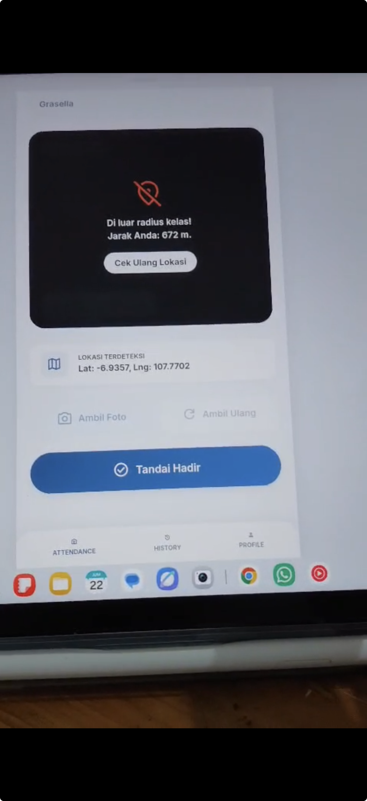

## Kompetensi target

Menghubungkan solution mechanism dengan problem, benefit, dan value yang relevan.

## Evidence wajib

- Attention evidence dan problem–solution link.
- Interest pitch dengan evidence atau demonstration.
- Response, state assessment, hidden concern, dan adaptation.

::: {.callout-tip title="Lihat contoh pengisian"}
[Buka contoh fiktif Minggu 7](../examples/week-07.qmd) untuk melihat tingkat kekonkretan evidence dan analisis. Jangan menyalin contoh sebagai evidence pribadi.
:::

## Konteks performance

**Tanggal dan setting:** Kegiatan ini merupakan bagian dari tugas besar mata kuliah Pengenalan Rekayasa dan Desain (PRD). Kelompok saya mengangkat fenomena titip absen di ITB dan mengembangkan prototype website presensi dengan verifikasi dua langkah. Pada akhir proyek, kami mempresentasikan dan mendemonstrasikan prototype tersebut kepada dosen.

**Persons dan relationship:** Target komunikasi kami adalah dosen mata kuliah PRD. Dosen berperan sebagai penilai yang perlu memahami relevansi masalah, cara kerja solusi, dan kesesuaian prototype dengan masalah yang kami angkat. Saya merupakan anggota kelompok yang bertanggung jawab membuat interface website dan membantu sebagian proses coding.

**Objective dan initial state:** Objective kami adalah membuat dosen melihat bahwa titip absen merupakan masalah yang memerlukan solusi dan memahami bagaimana prototype kami dapat mengurangi praktik tersebut. Sebelum menjelaskan solusi, kami membangun Attention melalui hasil survei dan observasi langsung terhadap fenomena titip absen di lingkungan ITB.

## Attention evidence dan solution hypothesis

Kelompok kami memilih masalah titip absen karena kami pernah melihat fenomena tersebut secara langsung. Kami juga melakukan survei untuk mengetahui bahwa masalah ini tidak hanya berasal dari asumsi kelompok. Evidence tersebut digunakan untuk menunjukkan bahwa titip absen merupakan masalah nyata yang perlu diperhatikan.

**Solution hypothesis:** Website presensi dengan verifikasi lokasi dan wajah dapat mempersulit mahasiswa melakukan presensi dari luar kampus atau mewakili mahasiswa lain.

| Problem | Mechanism | Expected benefit | Value bagi target |
|---|---|---|---|
| Mahasiswa dapat melakukan titip absen | Sistem memeriksa koordinat ponsel dan hanya menerima presensi dari area ITB | Presensi dari luar area kampus dapat ditolak | Data kehadiran menjadi lebih sesuai dengan keberadaan mahasiswa |
| Identitas pengguna belum tentu sesuai dengan mahasiswa yang tercatat | Mahasiswa mengambil selfie yang menyimpan informasi lokasi dan waktu serta digunakan untuk konfirmasi wajah | Identitas dan kondisi saat presensi dapat diverifikasi | Kemungkinan presensi yang diwakilkan oleh orang lain dapat dikurangi |

Ide solusi tersebut berasal dari diskusi bersama seluruh anggota kelompok. Kontribusi utama saya adalah membuat interface website agar alur verifikasi dapat dipahami pengguna serta membantu sebagian coding website.

## Pitch dan demonstration

Dalam presentasi, kami menjelaskan bahwa fenomena titip absen sudah menjadi masalah yang cukup mengkhawatirkan dan mulai dianggap sebagai kebiasaan oleh sebagian mahasiswa. Setelah menyampaikan hasil survei dan observasi, kami mendemonstrasikan prototype website sebagai solusi.

Kami menunjukkan bahwa proses presensi tidak hanya meminta mahasiswa menekan tombol hadir. Sistem terlebih dahulu memeriksa apakah koordinat ponsel berada di area ITB. Mahasiswa kemudian perlu mengambil selfie untuk menyimpan lokasi dan waktu serta melakukan konfirmasi wajah. Melalui demonstrasi ini, dosen dapat melihat hubungan antara masalah titip absen dan setiap mekanisme yang kami rancang.

Saya berkontribusi dengan mengembangkan interface yang digunakan dalam demonstrasi dan membantu sebagian implementasi teknisnya. Interface tersebut membantu menyampaikan solusi secara visual, sehingga penjelasan tidak hanya bergantung pada uraian lisan.

## Response, hidden concern, dan adaptation

Dosen terlihat memberikan respons positif terhadap presentasi dan prototype kami. Signal **Interest** muncul ketika dosen bertanya apakah prototype tersebut benar-benar dapat bekerja apabila seseorang mencoba melakukan presensi dari luar ITB. Pertanyaan ini menunjukkan bahwa dosen tidak hanya mengakui masalah, tetapi ingin mengetahui apakah mekanisme pembatasan lokasi benar-benar sesuai dengan situasi nyata.

Respons tersebut memperlihatkan concern utama mengenai **keandalan verifikasi lokasi**. Dosen ingin memastikan bahwa fitur lokasi bukan sekadar konsep pada interface, tetapi dapat membedakan presensi di dalam dan di luar area ITB.

Sebagai respons, kami tidak hanya mengulang penjelasan mengenai fitur. Kami langsung menunjukkan bukti pengujian ketika sistem digunakan untuk mencoba presensi dari kos yang berada di luar ITB. Bukti tersebut menunjukkan bagaimana prototype merespons percobaan presensi dari luar area yang ditentukan. Adaptasi ini membuat komunikasi berubah dari penjelasan konsep menjadi demonstrasi berbasis evidence.

## Evidence

::: {.evidence-block}
Evidence utama berikut menunjukkan hasil pengujian prototype ketika presensi dicoba dari kos yang berada di luar radius kelas. Sistem mendeteksi bahwa perangkat berjarak 672 meter dan menolak proses presensi. Hasil ini digunakan untuk menjawab pertanyaan dosen mengenai kemampuan verifikasi lokasi.

{fig-alt="Screenshot prototype yang menampilkan pesan di luar radius kelas dengan jarak 672 meter." width="55%"}

Evidence pendukung lain yang dapat dilampirkan adalah hasil survei, screenshot interface lainnya, dokumentasi demonstrasi, dan slide presentasi yang menghubungkan masalah dengan solusi.

Kontribusi saya dapat ditunjukkan melalui screenshot halaman interface yang saya buat dan bagian prototype atau dokumentasi kode yang saya bantu kerjakan. Data pribadi, foto wajah, koordinat yang terlalu spesifik, dan identitas responden survei perlu disamarkan sebelum evidence dimasukkan ke portofolio.
:::

## Analisis komunikasi

| Elemen | Evidence dan analisis |
|---|---|
| Person & character | Dosen diposisikan sebagai target yang menilai relevansi masalah dan kelayakan solusi. Penjelasan diarahkan pada evidence dan cara kerja prototype. |
| Objective & state | Objective kami adalah membawa dosen dari pengakuan terhadap masalah menuju Interest pada solusi. Pertanyaan mengenai presensi dari luar ITB menjadi signal bahwa dosen ingin memahami fit solusi. |
| Repertoire & language | Kami menggunakan survei, observasi, presentasi, interface, dan demonstrasi prototype agar informasi disampaikan secara bertahap dan tidak hanya berupa daftar fitur. |
| Response & adaptation | Pertanyaan dosen mengungkap concern tentang keandalan verifikasi lokasi. Kami beradaptasi dengan menunjukkan bukti pengujian presensi dari kos. |
| Agreement/action | Dosen menerima penjelasan lanjutan dan melihat bukti pengujian prototype. Tidak ada persetujuan implementasi nyata karena konteksnya masih berupa tugas dan prototype. |
| Relationship outcome | Respons dosen tetap positif dan diskusi berfokus pada pengujian kemampuan solusi, bukan hanya tampilan website. |

## Feedback dan tindak lanjut

**Feedback yang diterima:** Dosen menunjukkan ketertarikan dengan menanyakan apakah prototype benar-benar bekerja ketika presensi dilakukan dari luar ITB. Pertanyaan tersebut menjadi feedback bahwa klaim mengenai verifikasi lokasi perlu didukung oleh bukti pengujian.

**Adaptation/replay:** Kami merespons dengan menunjukkan bukti percobaan presensi dari kos yang berada di luar ITB. Jika mengulang presentasi, saya akan menampilkan hasil pengujian di dalam dan di luar ITB sejak awal agar batas kerja fitur dapat dibandingkan dengan lebih jelas.

**Next practice:** Saya akan berlatih menyiapkan satu demonstrasi untuk setiap klaim utama dalam solusi, termasuk kondisi ketika fitur berhasil dan ketika sistem menolak tindakan pengguna.

## Self-assessment

| Dimensi | Skor 1–4 | Evidence singkat |
|---|---:|---|
| Person & Character | 3 | Presentasi disesuaikan dengan peran dosen sebagai penilai masalah dan solusi |
| Objective & State | 3 | Pertanyaan dosen digunakan sebagai signal perpindahan dari Attention menuju Interest |
| Repertoire, Language & AI | 3 | Survei, interface, presentasi, dan demonstrasi digunakan secara berlapis |
| Response & Adaptation | 4 | Concern mengenai lokasi dijawab dengan bukti pengujian dari luar ITB |
| Agreement, Action & Relationship | 3 | Dosen melihat bukti kerja prototype, tetapi belum ada implementasi nyata |

**Total: 16/20 — Kompeten.**

::: {.assessor-only}
### Assessment dosen

**Skor:** — / 20  
**Evidence yang mendukung:** —  
**Prioritas perbaikan:** —  
**Keputusan:** Belum dinilai / Perlu revisi / Tercapai
:::
