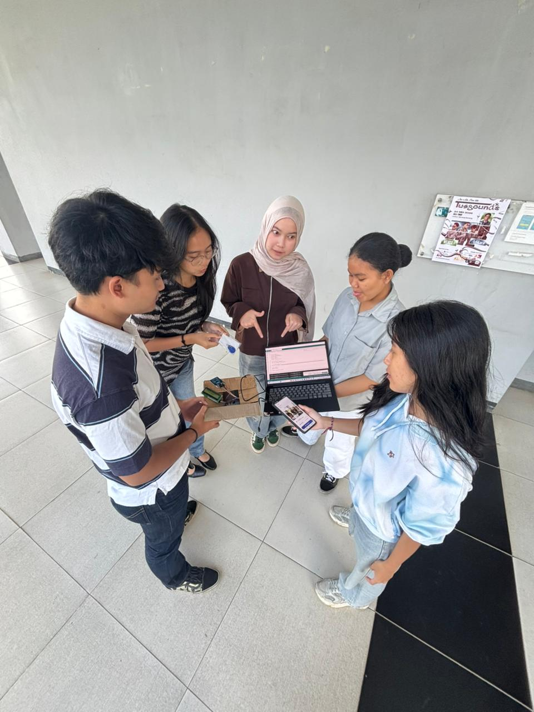

## Kompetensi target

Membangun desired state bersama target dan menghubungkannya dengan solution secara kredibel.

## Evidence wajib

- Current dan desired state milik person.
- Feature–benefit–value–outcome chain.
- Risk, evidence threshold, response, dan adaptation.

::: {.callout-tip title="Lihat contoh pengisian"}
[Buka contoh fiktif Minggu 9](../examples/week-09.qmd) untuk melihat tingkat kekonkretan evidence dan analisis. Jangan menyalin contoh sebagai evidence pribadi.
:::

## Konteks performance

**Tanggal dan setting:** Pengalaman ini terjadi selama pengerjaan tugas besar mata kuliah Pengenalan Rekayasa dan Desain (PRD). Kelompok saya mengembangkan prototype sistem presensi untuk mengurangi fenomena titip absen di ITB. Selama proses pengembangan, kami melakukan asistensi dengan dosen beberapa kali untuk membahas kesesuaian solusi dengan masalah.

**Persons dan relationship:** Target komunikasi kami adalah dosen mata kuliah PRD. Dosen berperan sebagai pembimbing dan penilai yang memberikan arahan mengenai kondisi yang perlu dicapai oleh solusi. Saya merupakan anggota kelompok yang mengerjakan interface website, membantu sebagian coding, dan mengusulkan penggunaan RFID sebagai tambahan perangkat keras.

**Objective dan initial state:** Objective awal kami adalah meyakinkan dosen bahwa website dengan pemeriksaan lokasi dan selfie dapat membantu mengurangi titip absen. Dosen sudah memahami cara kerja solusi tersebut, tetapi belum menganggap website saja cukup untuk memastikan mahasiswa benar-benar berada di kelas. Dengan demikian, state dosen sudah melewati Interest dan mulai membahas outcome yang benar-benar ia inginkan dari sistem.

## Current dan desired state

| Elemen | Rumusan berdasarkan respons dosen |
|---|---|
| Current state | Prototype masih mengandalkan GPS dan selfie pada website untuk memverifikasi kehadiran mahasiswa |
| Gap | Lokasi GPS dan selfie masih dapat dimanipulasi sehingga keberadaan mahasiswa di dalam kelas belum dapat dipastikan dengan kuat |
| Desired state | Terdapat perangkat fisik di ruang kelas yang harus digunakan mahasiswa sebelum melanjutkan proses presensi di website |
| Value | Dosen memperoleh keyakinan yang lebih kuat bahwa mahasiswa benar-benar datang ke kelas, bukan hanya mengirim data melalui website |
| Acceptable risk | Solusi masih berada pada tahap prototype dan perlu dibuktikan melalui demonstrasi perangkat serta alur website |
| Evidence threshold | Kartu dapat dibaca oleh perangkat RFID dan hasil tap membuat nama mahasiswa tersedia sebagai pilihan presensi di website |

Desired state tersebut tidak berasal dari asumsi kelompok. Dalam asistensi, dosen menyampaikan bahwa ia menginginkan perangkat keras di ruang kelas karena GPS dan selfie masih dapat dimanipulasi. Masukan ini mengubah cara kami melihat solusi: tujuan sistem bukan hanya menambah langkah verifikasi digital, tetapi membangun hubungan antara kehadiran fisik dan proses presensi pada website.

## Feature–benefit–value–outcome chain

`Tap kartu pada reader RFID di kelas` → sistem mencatat bahwa kartu digunakan pada perangkat fisik → nama mahasiswa baru tersedia dalam pilihan presensi di website → mahasiswa dapat melanjutkan verifikasi dengan selfie → bukti kehadiran tidak hanya bergantung pada GPS dan foto → dosen memiliki keyakinan lebih kuat bahwa mahasiswa benar-benar datang ke kelas.

Rangkaian tersebut tetap merupakan hypothesis dari prototype. Adanya RFID menambah lapisan verifikasi, tetapi tidak berarti sistem sudah bebas dari seluruh kemungkinan kecurangan atau kegagalan teknis.

| Feature | Benefit | Value | Expected outcome |
|---|---|---|---|
| Reader RFID ditempatkan di kelas | Mahasiswa harus melakukan interaksi dengan perangkat fisik sebelum presensi | Kehadiran tidak hanya ditentukan oleh data dari ponsel | Sistem lebih mampu menghubungkan presensi dengan keberadaan di kelas |
| Nama muncul di website setelah kartu ditap | Hanya mahasiswa yang telah melewati tahap RFID yang dapat melanjutkan alur | Proses verifikasi menjadi berlapis dan lebih terkontrol | Kemungkinan presensi tanpa datang ke kelas dapat dikurangi |
| Selfie dilakukan setelah tap kartu | Identitas pada tahap website tetap dikonfirmasi | RFID dan verifikasi visual saling melengkapi | Data presensi memberikan evidence yang lebih kuat bagi dosen |

## Percakapan, response, dan adaptation

Pada beberapa sesi asistensi, kami menjelaskan prototype awal yang menggunakan lokasi GPS dan selfie. Dosen menanggapi bahwa kedua mekanisme tersebut masih dapat dimanipulasi. Ia menginginkan adanya sebuah device di ruang kelas, sehingga solusi tidak hanya berbentuk website.

Respons ini menjadi signal **Desire** karena dosen tidak lagi sekadar menanyakan cara kerja solusi. Ia menyampaikan keadaan yang ingin dicapai untuk konteksnya sendiri: sistem perlu memiliki hubungan dengan kehadiran fisik mahasiswa di kelas.

Saya kemudian mengusulkan penggunaan RFID. Dalam alur yang direvisi, mahasiswa datang ke kelas dan melakukan tap kartu pada reader RFID. Setelah tap berhasil, nama mahasiswa baru muncul sebagai pilihan presensi di website. Mahasiswa kemudian melanjutkan tahap selfie. Kelompok kami tidak berhenti pada ide, tetapi benar-benar membuat prototype perangkat keras tersebut.

Adaptasi ini bersifat substantif karena masukan dosen mengubah arsitektur solusi dari verifikasi yang sepenuhnya berbasis website menjadi gabungan hardware dan website. Kami tidak lagi menyatakan bahwa GPS dan selfie saja cukup untuk mencapai desired state dosen.

## Risk dan evidence

Risiko utama yang diidentifikasi dosen adalah manipulasi GPS dan selfie. RFID digunakan sebagai safeguard tambahan dengan menempatkan satu tahap verifikasi pada perangkat fisik di ruang kelas. Meskipun demikian, prototype RFID bukan jaminan bahwa semua bentuk kecurangan dapat dihilangkan. Sistem juga masih perlu diuji lebih lanjut untuk menilai keandalan pembacaan kartu, integrasi data, dan penggunaan pada situasi kelas yang sebenarnya.

::: {.evidence-block}
Evidence utama adalah foto kelompok saat mendemonstrasikan prototype perangkat RFID yang terhubung dengan laptop dan website. Foto tersebut membuktikan bahwa masukan dosen menghasilkan perubahan nyata dalam bentuk integrasi hardware dan software, bukan hanya tambahan ide dalam laporan.

{fig-alt="Foto anggota kelompok mendemonstrasikan prototype RFID, laptop, dan tampilan website presensi." width="65%"}

Jika tersedia, evidence dapat diperkuat dengan foto kartu saat ditempelkan pada reader dan screenshot website yang menunjukkan nama mahasiswa muncul setelah tap berhasil. Identitas mahasiswa, nomor kartu, dan informasi pribadi perlu disamarkan.

Kontribusi saya adalah mengusulkan penggunaan RFID, mengerjakan interface website, dan membantu sebagian coding prototype.
:::

## Analisis komunikasi

| Elemen | Evidence dan analisis |
|---|---|
| Person & character | Dosen dipahami sebagai target yang tidak hanya membutuhkan fitur, tetapi membutuhkan keyakinan bahwa mahasiswa benar-benar berada di kelas. |
| Objective & state | Objective berubah dari menjelaskan website menjadi membangun solusi yang sesuai dengan desired state dosen. Masukan mengenai perangkat fisik menjadi signal Desire. |
| Repertoire & language | Kami menggunakan asistensi, penjelasan alur, interface, dan prototype untuk mengembangkan pembicaraan dari konsep menuju solusi yang dapat didemonstrasikan. |
| Response & adaptation | Concern tentang manipulasi GPS dan selfie mengubah arsitektur solusi. Saya mengusulkan RFID dan kelompok membuat prototype perangkat kerasnya. |
| Agreement/action | Tindakan konkretnya adalah pengembangan alur baru: tap RFID, nama tersedia di website, lalu selfie. |
| Relationship outcome | Masukan dosen digunakan sebagai dasar revisi, sehingga proses asistensi menjadi kolaborasi dalam merumuskan desired state solusi. |

## Feedback dan tindak lanjut

**Feedback yang diterima:** Dosen menyampaikan bahwa verifikasi GPS dan selfie masih dapat dimanipulasi. Ia menginginkan adanya perangkat keras di ruang kelas agar solusi tidak hanya mengandalkan website.

**Adaptation/replay:** Saya mengusulkan RFID dan kelompok mengubah alur presensi. Mahasiswa perlu melakukan tap kartu di kelas sebelum namanya muncul sebagai pilihan pada website dan dapat melanjutkan verifikasi selfie.

**Next practice:** Pada asistensi berikutnya, saya akan menanyakan evidence threshold secara lebih eksplisit, misalnya demonstrasi atau hasil pengujian apa yang perlu dilihat dosen agar solusi dinilai telah memenuhi desired state.

## Self-assessment

| Dimensi | Skor 1–4 | Evidence singkat |
|---|---:|---|
| Person & Character | 3 | Desired state dirumuskan berdasarkan kebutuhan dosen, bukan hanya asumsi kelompok |
| Objective & State | 4 | Current state, gap, desired state, dan risiko dapat dibedakan dengan jelas |
| Repertoire, Language & AI | 3 | Value chain diperlakukan sebagai hypothesis dan batas prototype dinyatakan |
| Response & Adaptation | 4 | Concern dosen mengubah solusi dari website menjadi integrasi RFID dan website |
| Agreement, Action & Relationship | 2 | Prototype benar-benar dibuat, tetapi respons akhir dosen dan uji kelas belum terdokumentasi |

**Total: 16/20 — Kompeten.**

::: {.assessor-only}
### Assessment dosen

**Skor:** — / 20  
**Evidence yang mendukung:** —  
**Prioritas perbaikan:** —  
**Keputusan:** Belum dinilai / Perlu revisi / Tercapai
:::
