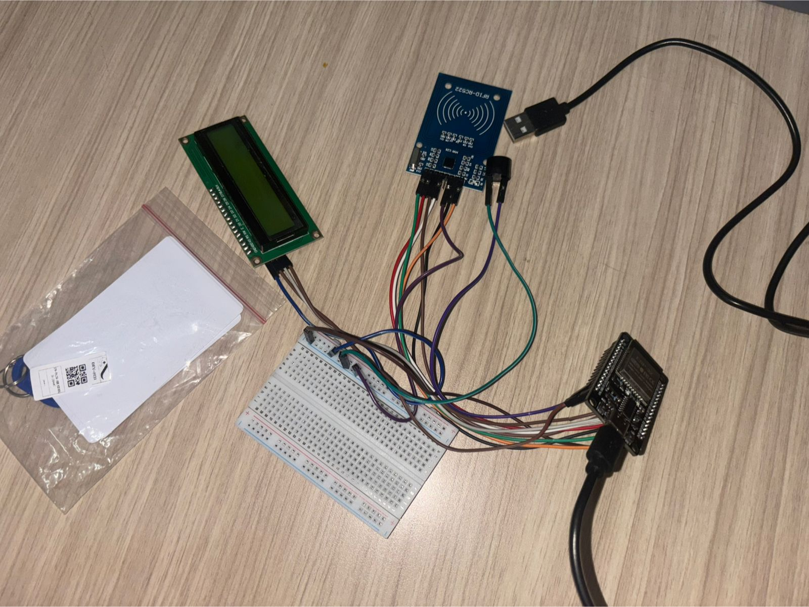

## Kompetensi target

Menemukan desire–action gap dan menghasilkan agreement yang feasible serta eksplisit.

## Evidence wajib

- Barrier dan authority map.
- Options dan trade-off yang dibahas.
- Agreement dengan owner/deadline serta bukti action atau review.

::: {.callout-tip title="Lihat contoh pengisian"}
[Buka contoh fiktif Minggu 10](../examples/week-10.qmd) untuk melihat tingkat kekonkretan evidence dan analisis. Jangan menyalin contoh sebagai evidence pribadi.
:::

## Konteks performance

**Tanggal dan setting:** Pengalaman ini terjadi dalam pengerjaan tugas besar mata kuliah Pengenalan Rekayasa dan Desain (PRD). Setelah asistensi dengan dosen, kelompok kami memutuskan untuk menambahkan perangkat RFID pada prototype sistem presensi. Tahap ini mengubah keinginan membuat sistem yang lebih sulit dimanipulasi menjadi tindakan pengadaan komponen, simulasi, perakitan, dan pengujian.

**Persons dan relationship:** Orang-orang yang terlibat adalah saya dan anggota kelompok tugas besar. Saya bertanggung jawab membeli komponen, mengerjakan interface website, dan membantu sebagian coding. Pengerjaan simulasi dan prototype dilakukan sebagai kerja kelompok, tetapi pembagian owner teknis setiap bagian tidak terdokumentasi secara rinci.

**Objective dan initial state:** Objective kami adalah menghasilkan prototype RFID yang dapat digunakan bersama website sebelum proyek akhir dipresentasikan. Pada awal tahap ini, kelompok sudah menginginkan solusi hardware–software, tetapi belum ada anggota yang memiliki pengalaman membangun prototype RFID atau mensimulasikannya melalui Wokwi.

## Desire–action gap

Kelompok kami sudah memiliki keinginan untuk menambahkan perangkat fisik di kelas, tetapi keinginan tersebut belum langsung menjadi action. Hambatan utamanya adalah keterbatasan pengalaman, ketergantungan pada komponen fisik, serta kegagalan berulang selama pengembangan.

| Barrier | Person dengan authority/responsibility | Respons |
|---|---|---|
| Belum ada anggota yang berpengalaman membangun prototype RFID | Seluruh kelompok | Belajar melalui percobaan, simulasi Wokwi, dan pengujian berulang |
| Belum berpengalaman mensimulasikan rangkaian di Wokwi | Seluruh kelompok | Mencoba menyusun dan memperbaiki simulasi bersama selama proses pengembangan |
| Komponen RFID-RC522 pertama tidak dapat digunakan | Saya sebagai penanggung jawab pembelian | Membeli kembali komponen RFID-RC522 sebagai pengganti |
| Prototype beberapa kali gagal bekerja | Seluruh kelompok | Memeriksa ulang rangkaian dan coding sampai prototype dapat berjalan |
| Interface dan hardware perlu menjadi satu alur presensi | Saya pada interface dan bantuan coding; kelompok pada integrasi prototype | Mengembangkan alur agar perangkat RFID mendukung proses pada website |

Authority dalam pengalaman ini bersifat terbagi. Saya memiliki authority atas tindakan pembelian komponen, sedangkan keputusan teknis dan penyelesaian prototype dilakukan bersama kelompok. Dosen memberikan desired outcome, tetapi tidak menjalankan proses perakitan.

## Options dan trade-off

Ketika RFID-RC522 pertama tidak dapat digunakan, kami menghadapi dua tindakan yang praktis: terus melakukan pemeriksaan pada komponen yang sama atau menggantinya agar proses pengembangan dapat dilanjutkan. Pemeriksaan ulang tidak membutuhkan pembelian baru, tetapi berisiko menghabiskan lebih banyak waktu pada komponen yang tetap tidak berfungsi. Membeli RFID-RC522 baru menambah biaya dan waktu pengadaan, tetapi memberi kelompok kesempatan melanjutkan perakitan dengan komponen pengganti.

Saya memilih membeli kembali RFID-RC522 agar hambatan komponen tidak menghentikan keseluruhan prototype. Keputusan ini tidak menjamin rangkaian langsung berhasil karena kelompok masih perlu menyelesaikan masalah pada simulasi, wiring, dan coding. Namun, penggantian komponen merupakan langkah yang berada dalam tanggung jawab saya dan dapat segera dilakukan.

## Agreement dan pembagian action

Agreement operasional yang dapat dibuktikan dari proses kelompok adalah sebagai berikut:

| Elemen | Agreement |
|---|---|
| Scope | Membuat prototype RFID fisik yang mendukung alur presensi pada website |
| Owner | Saya membeli komponen, mengembangkan interface, dan membantu coding; proses simulasi, perakitan, dan pengujian diselesaikan bersama kelompok |
| Waktu | Prototype diselesaikan pada tahap pengerjaan tugas besar sebelum demonstrasi akhir proyek; tanggal internal yang lebih spesifik tidak terdokumentasi |
| Dependency | Perakitan fisik bergantung pada tersedianya komponen RFID-RC522 yang berfungsi, sedangkan integrasi website bergantung pada hasil pembacaan perangkat |
| Review | Kelompok memeriksa prototype melalui percobaan berulang sampai rangkaian akhir dapat berjalan |

Agreement ini menghasilkan action nyata, tetapi belum sekuat agreement tertulis yang mencantumkan owner setiap bagian dan deadline harian. Sebagian koordinasi berlangsung selama proses pengerjaan, sehingga dokumentasi pembagian tanggung jawab masih terbatas.

## Action evidence dan adaptation

Saya menjalankan tanggung jawab pembelian komponen. Ketika RFID-RC522 pertama tidak dapat digunakan, saya membeli komponen pengganti. Selama pengerjaan, prototype beberapa kali gagal. Kelompok melanjutkan proses pemeriksaan dan perbaikan sampai rangkaian akhirnya dapat berjalan dengan lancar.

Adaptasi terpenting bukan hanya perubahan bahasa atau rencana, melainkan tindakan mengganti komponen yang menghambat pengerjaan dan mengulangi proses pengujian. Hasil akhirnya adalah rangkaian prototype fisik yang terdiri dari reader RFID, kartu, display, breadboard, controller, dan koneksi antarkomponen.

::: {.evidence-block}
Foto berikut menunjukkan prototype akhir yang berhasil dirakit setelah penggantian RFID-RC522 dan beberapa kali percobaan. Evidence ini membuktikan adanya action nyata, bukan hanya intention untuk menambahkan hardware.

{fig-alt="Rangkaian prototype RFID yang terdiri dari reader RC522, kartu RFID, display, breadboard, controller, dan kabel penghubung." width="80%"}

Kontribusi saya adalah membeli komponen, mengganti RFID-RC522 yang tidak dapat digunakan, membuat interface website, dan membantu sebagian coding. Evidence dapat diperkuat lebih lanjut dengan screenshot chat pembagian tugas, bukti pembelian yang telah disensor, atau dokumentasi hasil pengujian.
:::

## Analisis komunikasi

| Elemen | Evidence dan analisis |
|---|---|
| Person & character | Tanggung jawab saya ditentukan berdasarkan kebutuhan kelompok, terutama pengadaan komponen serta kontribusi pada interface dan coding. |
| Objective & state | Kelompok berpindah dari keinginan menambahkan hardware menuju tindakan membeli, merakit, dan menguji prototype. |
| Repertoire & language | Koordinasi dilengkapi dengan simulasi, percobaan fisik, dan pemeriksaan hasil, bukan hanya diskusi mengenai rencana. |
| Response & adaptation | Kegagalan RFID-RC522 direspons dengan pembelian komponen pengganti. Kegagalan prototype direspons melalui percobaan dan perbaikan berulang. |
| Agreement/action | Scope dan tindakan utama tercapai, tetapi owner teknis lain serta deadline rinci belum terdokumentasi secara eksplisit. |
| Relationship outcome | Kelompok tetap melanjutkan pekerjaan meskipun belum berpengalaman dan mengalami beberapa kegagalan sampai prototype berjalan. |

## Feedback dan tindak lanjut

**Feedback yang diterima:** Tidak ada feedback formal yang terdokumentasi pada tahap pengadaan dan perakitan ini. Namun, kegagalan komponen dan prototype menjadi feedback teknis langsung bahwa rencana awal belum dapat dijalankan tanpa penggantian serta perbaikan.

**Adaptation/replay:** Saya membeli RFID-RC522 pengganti setelah komponen pertama tidak dapat digunakan. Kelompok kemudian melanjutkan pemeriksaan dan percobaan sampai prototype akhir berjalan.

**Next practice:** Pada proyek berikutnya, saya akan mendorong kelompok membuat agreement tertulis yang mencantumkan owner setiap bagian, deadline internal, dependency, dan jadwal review. Saya juga akan menguji komponen lebih awal agar kerusakan tidak baru diketahui ketika proses integrasi berlangsung.

## Self-assessment

| Dimensi | Skor 1–4 | Evidence singkat |
|---|---:|---|
| Person & Character | 3 | Responsibility saya pada pengadaan, interface, dan bantuan coding dapat diidentifikasi |
| Objective & State | 3 | Desire–action gap dan barrier pengalaman serta komponen dijelaskan |
| Repertoire, Language & AI | 3 | Simulasi, perakitan, dan pengujian digunakan untuk mendukung koordinasi |
| Response & Adaptation | 4 | RFID-RC522 yang gagal diganti dan prototype diperbaiki melalui percobaan berulang |
| Agreement, Action & Relationship | 2 | Action dan hasil akhir terbukti, tetapi owner teknis dan deadline rinci tidak terdokumentasi |

**Total: 15/20 — Kompeten.**

::: {.assessor-only}
### Assessment dosen

**Skor:** — / 20  
**Evidence yang mendukung:** —  
**Prioritas perbaikan:** —  
**Keputusan:** Belum dinilai / Perlu revisi / Tercapai
:::
