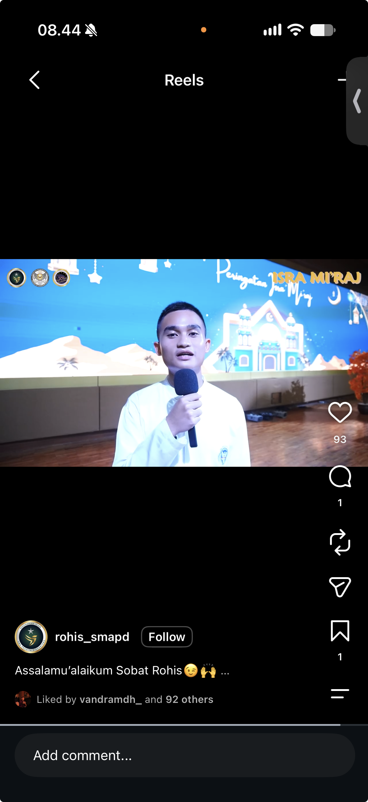

## Kompetensi target

Memfasilitasi beberapa person dengan objective, constraint, authority, dan state berbeda.

## Evidence wajib

- Stakeholder person map dan multi-state TAIDA.
- Position–interest analysis, common ground, dan options.
- Negotiation evidence, agreement/dissent, dan relationship review.

::: {.callout-tip title="Lihat contoh pengisian"}
[Buka contoh fiktif Minggu 11](../examples/week-11.qmd) untuk melihat tingkat kekonkretan evidence dan analisis. Jangan menyalin contoh sebagai evidence pribadi.
:::

## Konteks performance

**Tanggal dan setting:** Pengalaman ini terjadi ketika saya masih SMA dan menjadi Ketua Pelaksana Peringatan Isra Mikraj 1445 H. Pada tahun-tahun sebelumnya, rangkaian acara selalu mencakup makan bersama di aula sekolah yang melibatkan seluruh siswa, baik Muslim maupun non-Muslim.

**Persons dan relationship:** Stakeholder yang terlibat adalah saya sebagai Ketua Pelaksana, seluruh panitia, pembina organisasi Kerohanian Islam (Rohis), wakil kepala sekolah bidang kesiswaan, dan siswa non-Muslim sebagai pihak yang terdampak. Identitas sekolah dan individu tidak dicantumkan untuk menjaga privasi.

**Objective dan initial state:** Objective awal saya dan panitia adalah mempertahankan kegiatan makan bersama yang inklusif. Namun, pembina Rohis melarang keterlibatan siswa non-Muslim karena terdapat konflik antara orang tua siswa Muslim dan non-Muslim. Saya menilai larangan tersebut bertentangan dengan nilai inklusivitas yang dipegang Rohis. Tujuan negosiasi kemudian berubah menjadi mencari keputusan yang dapat dijalankan tanpa mengabaikan dampaknya bagi siswa non-Muslim.

## Stakeholder dan multi-state map

| Person | Position | Interest/constraint | Authority | State |
|---|---|---|---|---|
| Saya sebagai Ketua Pelaksana | Siswa non-Muslim tetap diundang ke makan bersama | Menjaga tradisi kebersamaan dan nilai inklusivitas Rohis | Memimpin rapat dan pelaksanaan, tetapi tidak memiliki izin final | Desire menuju Action |
| Seluruh panitia | Setuju mengundang siswa non-Muslim | Menjalankan acara yang inklusif dan konsisten dengan tahun sebelumnya | Memberi pendapat serta menjalankan keputusan acara | Desire |
| Pembina Rohis | Tidak memperbolehkan kegiatan bersama siswa non-Muslim | Menghindari bertambahnya konflik antara orang tua siswa Muslim dan non-Muslim | Membimbing Rohis dan dapat menolak rancangan kegiatan | Action pada position penolakan |
| Wakil kepala sekolah bidang kesiswaan | Tidak memperbolehkan kegiatan bersama siswa non-Muslim | Menjaga kegiatan siswa tetap sesuai keputusan dan kondisi sekolah | Memiliki authority final terkait kegiatan kesiswaan | Action pada keputusan akhir |
| Siswa non-Muslim | Tidak menyampaikan position secara langsung dalam rapat | Terdampak oleh perubahan dari tradisi tahun sebelumnya dan membutuhkan kejelasan | Tidak terlibat langsung dalam pengambilan keputusan | State tidak dapat dinilai secara langsung |

State tidak dapat disamaratakan untuk seluruh pihak. Panitia sudah berada pada Desire karena menginginkan outcome inklusif, sedangkan pembina dan wakil kepala sekolah sudah siap menjalankan keputusan yang membatasi kegiatan. Siswa non-Muslim tidak hadir dalam negosiasi sehingga saya tidak menganggap diamnya mereka sebagai persetujuan.

## Position–interest analysis dan common ground

Position panitia adalah tetap mengundang siswa non-Muslim. Interest di baliknya bukan sekadar mempertahankan format lama, tetapi menjaga inklusivitas dan kebersamaan di lingkungan sekolah. Sebaliknya, position pembina dan wakil kepala sekolah adalah melarang kegiatan bersama. Constraint mereka adalah adanya konflik orang tua yang membuat kegiatan lintas kelompok dinilai tidak dapat dilaksanakan pada tahun tersebut.

Common ground yang masih dapat digunakan adalah semua pihak ingin Peringatan Isra Mikraj tetap berjalan tanpa memperburuk konflik yang sudah ada. Common ground ini tidak menghapus perbedaan tentang keterlibatan siswa non-Muslim, tetapi menjadi dasar untuk mencari keputusan yang masih dapat dilaksanakan oleh panitia.

## Negotiation evidence

Saya terlebih dahulu mengadakan rapat dengan seluruh panitia. Dalam rapat tersebut, seluruh panitia setuju bahwa siswa non-Muslim seharusnya tetap diundang ke kegiatan makan bersama. Hasil rapat ini kemudian saya bawa ke pertemuan dengan pembina Rohis dan wakil kepala sekolah bidang kesiswaan.

Dalam pertemuan berikutnya, saya menyampaikan position panitia bahwa kegiatan bersama sebaiknya tetap dilaksanakan karena sesuai dengan tradisi sebelumnya dan nilai inklusivitas Rohis. Pembina dan wakil kepala sekolah tetap tidak memberikan izin. Perbedaan ini menunjukkan adanya power imbalance: panitia dapat menyampaikan aspirasi dan menjalankan acara, tetapi authority final berada pada pihak sekolah.

Saya tidak menganggap penolakan tersebut sebagai consensus. Panitia tetap memiliki disagreement terhadap keputusan, tetapi kami juga perlu menghasilkan keputusan operasional agar acara dapat dilanjutkan.

## Options dan trade-off

Dua opsi utama yang tersedia dalam negosiasi adalah:

1. **Membatalkan kegiatan makan bersama.** Opsi ini menghindari pelaksanaan kegiatan yang tidak lagi sesuai dengan rancangan inklusif panitia, tetapi menghilangkan salah satu bagian yang selalu ada pada peringatan tahun-tahun sebelumnya.
2. **Tetap mengadakan makan bersama tanpa siswa non-Muslim.** Opsi ini mempertahankan sebagian agenda dan memungkinkan acara berjalan, tetapi bertentangan dengan position panitia mengenai inklusivitas serta dapat menimbulkan pertanyaan dari siswa non-Muslim.

Opsi kedua akhirnya dipilih karena masih memungkinkan agenda acara berjalan di dalam batas izin sekolah. Untuk mengurangi dampak keputusan kepada pihak yang tidak dilibatkan dalam rapat, panitia meminta agar penjelasan kepada siswa non-Muslim tidak dibebankan kepada panitia saja.

## Agreement, dissent, dan action

Agreement akhir yang dicapai adalah:

- kegiatan makan bersama tetap diadakan tanpa melibatkan siswa non-Muslim pada tahun tersebut;
- wakil kepala sekolah bidang kesiswaan dan pembina Rohis bertanggung jawab menjelaskan keputusan kepada siswa non-Muslim;
- panitia menyesuaikan Rencana Anggaran Biaya (RAB) dan rundown yang sebelumnya dibuat berdasarkan kegiatan bersama seluruh siswa;
- panitia tetap menjalankan acara sesuai keputusan pihak yang memiliki authority final.

Agreement tersebut tidak berarti semua pihak memiliki pendapat yang sama. Panitia tetap menilai kegiatan inklusif sebagai pilihan yang lebih sesuai dengan nilai Rohis, tetapi menerima batas keputusan sekolah untuk pelaksanaan tahun itu. Specific disagreement ini penting dicatat agar kepatuhan terhadap keputusan tidak keliru dianggap sebagai perubahan nilai atau persetujuan penuh.

Action setelah rapat adalah panitia mengubah kembali RAB dan beberapa bagian rundown, lalu melaksanakan acara berdasarkan scope yang telah disetujui. Informasi mengenai apakah penjelasan kepada siswa non-Muslim benar-benar dilaksanakan tidak terdokumentasi dalam evidence yang tersedia, sehingga saya tidak menyatakan hal tersebut sebagai action yang telah terverifikasi.

## Evidence dan relationship review

::: {.evidence-block}
Evidence berikut adalah tangkapan layar dokumentasi pelaksanaan Peringatan Isra Mikraj 1445 H di aula sekolah. Foto tersebut membuktikan bahwa panitia tetap menjalankan acara setelah perubahan keputusan.

{fig-alt="Tangkapan layar dokumentasi Peringatan Isra Mikraj di aula sekolah dengan seorang pembawa acara di depan panggung." width="55%"}

Kontribusi saya adalah memimpin rapat panitia, membawa hasil rapat ke pembina dan wakil kepala sekolah, menyampaikan position panitia, serta membantu memastikan keputusan akhir dapat diterjemahkan menjadi perubahan RAB dan rundown.
:::

Hubungan kerja tetap dijaga dengan membedakan disagreement terhadap keputusan dari sikap terhadap orang yang mengambil keputusan. Panitia tidak memperoleh outcome awal yang diinginkan, tetapi tetap menjalankan tanggung jawabnya. Kelemahan proses ini adalah siswa non-Muslim sebagai pihak terdampak tidak memiliki perwakilan langsung dalam negosiasi.

## Analisis komunikasi

| Elemen | Evidence dan analisis |
|---|---|
| Person & character | Position, interest, constraint, dan authority panitia, pembina, wakil kepala sekolah, serta siswa non-Muslim dibedakan. |
| Objective & state | Saya mengelola beberapa state dan objective, lalu mengubah objective dari mempertahankan rancangan awal menjadi menghasilkan keputusan yang dapat dijalankan. |
| Repertoire & language | Rapat internal digunakan untuk membangun position panitia, kemudian hasilnya dibawa ke rapat dengan pihak yang memiliki authority final. |
| Response & adaptation | Penolakan pembina dan wakil kepala sekolah mendorong kompromi berupa perubahan scope serta pembagian tanggung jawab untuk menjelaskan keputusan. |
| Agreement/action | Agreement menghasilkan revisi RAB, revisi rundown, dan pelaksanaan acara, tetapi disagreement panitia tetap dicatat. |
| Relationship outcome | Panitia tetap menjalankan keputusan tanpa menghapus perbedaan nilai; keterwakilan siswa non-Muslim tetap menjadi kekurangan proses. |

## Penggunaan AI

AI digunakan setelah pengalaman berlangsung untuk membantu menyusun pengalaman ke dalam struktur portofolio Week 11 dan membedakan position, interest, constraint, authority, agreement, serta dissent. AI tidak digunakan untuk menciptakan rapat, keputusan, atau evidence. Saya memeriksa hasilnya agar tidak menambahkan kutipan, alasan, atau action yang tidak saya ketahui.

## Feedback dan tindak lanjut

**Feedback yang diterima:** Penolakan pembina Rohis dan wakil kepala sekolah menunjukkan bahwa argumentasi nilai inklusivitas belum dapat mengatasi constraint berupa konflik orang tua dan batas authority sekolah.

**Adaptation/replay:** Setelah usulan mengundang siswa non-Muslim tetap ditolak, panitia menerima perubahan scope, meminta pembina serta wakil kepala sekolah bertanggung jawab memberikan penjelasan, dan menyesuaikan RAB serta rundown.

**Next practice:** Jika menghadapi situasi serupa, saya akan mengusulkan keterlibatan perwakilan pihak yang terdampak atau setidaknya mengumpulkan pandangan mereka sebelum keputusan final, sehingga negosiasi tidak hanya membicarakan mereka tanpa memberi ruang pada suaranya.

## Self-assessment

| Dimensi | Skor 1–4 | Evidence singkat |
|---|---:|---|
| Person & Character | 3 | Stakeholder, power, interest, dan authority dipetakan secara terpisah |
| Objective & State | 3 | Beberapa objective dan state dikelola tanpa menganggap kelompok memiliki satu state |
| Repertoire, Language & AI | 3 | Rapat internal, penyampaian position, dan kompromi digunakan secara bertahap |
| Response & Adaptation | 3 | Penolakan mengubah scope, RAB, dan rundown serta menghasilkan pembagian tanggung jawab |
| Agreement, Action & Relationship | 3 | Agreement dan dissent dicatat, tetapi pihak terdampak tidak terwakili dan action penjelasan belum terverifikasi |

**Total: 15/20 — Kompeten.**

::: {.assessor-only}
### Assessment dosen

**Skor:** — / 20  
**Evidence yang mendukung:** —  
**Prioritas perbaikan:** —  
**Keputusan:** Belum dinilai / Perlu revisi / Tercapai
:::
